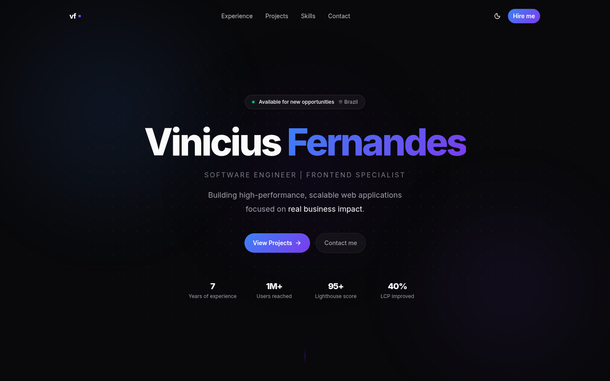

<p align="center">
  <a href="https://vinicius-frontend.vercel.app">
    
  </a>
</p>

<p align="center">
  <a href="https://vinicius-frontend.vercel.app"><strong>Ver o site</strong></a> ·
  <a href="#rodando-localmente">Rodar localmente</a> ·
  <a href="#arquitetura">Arquitetura</a> ·
  <a href="#conteúdo-sanity">Conteúdo (Sanity)</a>
</p>

# Portfólio · Vinicius Fernandes

Portfólio pessoal de uma página só (Software Engineer · Frontend Specialist). Todo o conteúdo (perfil, experiências, projetos, skills e diferenciais) vem do **Sanity CMS**. O site é renderizado no servidor com ISR e publicado na **Vercel**.

- **Produção:** https://vinicius-frontend.vercel.app

## Stack

Next.js 16 (App Router, RSC) · React 19 · TypeScript (strict) · Tailwind CSS v4 · shadcn/ui (estilo `radix-maia`, sobre Radix) · Sanity (`next-sanity`, GROQ) · `@t3-oss/env-nextjs` + Zod · next-themes · Biome

## Rodando localmente

Pré-requisitos: Node.js 20+ e npm.

```bash
npm install
cp .env.example .env.local   # preencha as variáveis abaixo
npm run dev                  # http://localhost:3000
```

### Variáveis de ambiente

Todas as variáveis são validadas na inicialização por `src/shared/lib/env.ts` (t3-env + Zod). Se faltar alguma, o build falha com uma mensagem clara.

| Variável                | Descrição                                          |
| ----------------------- | -------------------------------------------------- |
| `SANITY_PROJECT_ID`     | ID do projeto no Sanity                            |
| `SANITY_DATASET`        | Dataset (normalmente `production`)                 |
| `SANITY_API_VERSION`    | Versão da API em data (`YYYY-MM-DD`)               |
| `GOOGLE_TAG_MANAGER_ID` | Container do GTM (`GTM-XXXX`)                      |

Todas são **server-only**: nenhuma vai para o bundle do client.

### Scripts

| Comando             | O que faz                                                         |
| ------------------- | ----------------------------------------------------------------- |
| `npm run dev`       | Servidor de desenvolvimento (Turbopack)                           |
| `npm run build`     | Build de produção (precisa do Sanity acessível: a home é pré-renderizada) |
| `npm run start`     | Sobe o build de produção                                          |
| `npm run lint`      | `biome check` (lint + format + organização de imports)            |
| `npm run format`    | `biome format --write`                                            |
| `npm run typecheck` | `next typegen && tsc --noEmit` (gera os tipos de rota e checa)    |

Antes de abrir um PR, rode `npm run lint` e `npm run typecheck`.

## Arquitetura

A organização é **por feature**, no mesmo padrão dos projetos `salvia` e `listify`:

- cada domínio de conteúdo é uma pasta em `src/features/`;
- o que é compartilhado fica em `src/shared/`;
- `src/app/` só tem rotas e arquivos especiais do Next.

```
src/
├── app/                         # Só rotas e arquivos especiais do Next
│   ├── layout.tsx               # <html>, fontes, ThemeProvider, GTM, JSON-LD, Header/Footer
│   ├── page.tsx                 # Home: busca os dados das features e compõe as seções
│   ├── loading.tsx              # Skeleton da home
│   ├── opengraph-image.tsx      # OG image gerada (next/og)
│   ├── twitter-image.tsx
│   ├── robots.ts · sitemap.ts
│   └── globals.css              # Tokens (OKLCH), @theme inline, @layer base
│
├── features/                    # Um domínio de conteúdo do Sanity por pasta
│   ├── profile/                 # Hero, marquee de tecnologias, métricas
│   │   ├── components/          # hero-section, stats-section, tech-marquee, open-to-work-badge
│   │   ├── services/            # profile-service.ts → PROFILE_QUERY + getProfile()  (server-only)
│   │   ├── types/               # profile-types.ts → ProfileData, ProfileMetric…
│   │   └── index.ts             # barrel client-safe
│   ├── experience/              # + utils/sort-experiences.ts (regra pura de ordenação)
│   ├── projects/
│   ├── skills/
│   ├── differentials/
│   └── contact/                 # + utils/get-social-icon.ts
│
├── shared/                      # Tudo que não pertence a uma feature
│   ├── components/
│   │   ├── ui/                  # shadcn/ui (gerados pelo CLI)
│   │   ├── layout/              # header, footer, mobile-menu, theme-toggle
│   │   ├── effects/             # cursor-glow, noise-texture, gradient-top-edge, scroll-cue
│   │   ├── section.tsx          # Primitivos de seção (Section, SectionHeader, SectionTitle…)
│   │   ├── reveal.tsx           # Ilha client de scroll-reveal
│   │   ├── reveal-card.tsx      # Card com reveal + hover
│   │   ├── structured-data.tsx  # <script type="application/ld+json">
│   │   ├── icons.tsx            # Único ponto de import de ícones
│   │   └── count-up · cta-button · icon-box · statistic · tech-tag
│   ├── config/                  # fonts.ts, nav.ts, seo.ts (siteConfig + Metadata)
│   ├── hooks/                   # use-scroll-reveal, use-in-view-once, use-reduced-motion…
│   ├── lib/
│   │   ├── sanity/              # client.ts, fetch.ts (sanityFetch), types.ts (gerado)
│   │   ├── env.ts · dayjs.ts · json-ld.ts · utils.ts (cn)
│   └── styles/animations.css    # @keyframes e .reveal (importado no globals.css)
│
└── providers/                   # theme-provider (next-themes + atalho "D")
```

### Regras de dependência

```
app  ──►  features  ──►  shared
 │                         ▲
 └─────────────────────────┘
```

- **`app/`** importa de `features/` e `shared/`. Não tem regra de negócio nem query.
- **Uma feature nunca importa de outra feature.** Se duas precisam da mesma coisa, ela sobe para `shared/`.
- **`shared/`** não conhece nenhuma feature e nunca importa de `features/` nem de `app/`.
- **`shared/lib`** não importa de `shared/components`. A exceção é o `sanity/types.ts`, que é só tipo.

### Anatomia de uma feature

| Pasta / arquivo   | Conteúdo                                                                 |
| ----------------- | ------------------------------------------------------------------------ |
| `components/`     | Seção e cards da feature. São Server Components por padrão.              |
| `services/`       | Query GROQ (`defineQuery`) + função `getX()`. Começa com `import "server-only"`. |
| `types/`          | Alias do tipo gerado pelo TypeGen para a query (`PROJECTS_QUERY_RESULT[number]`). |
| `utils/`          | Funções puras (ordenação, mapeamentos). Sem React, sem I/O.              |
| `index.ts`        | Barrel **client-safe**: exporta componentes e tipos, **nunca** services. |

Services são importados pelo caminho direto (`@/features/projects/services/project-service`), e só em Server Components. O `server-only` faz o build quebrar se alguém importar um service num Client Component.

### Fluxo de dados

1. `app/page.tsx` chama os services de cada feature em paralelo (`Promise.all`).
2. Cada service chama `sanityFetch()` (`shared/lib/sanity/fetch.ts`), o **único** ponto de acesso ao Sanity:
   - `revalidate: 60` (ISR) por padrão;
   - **tags de cache** com o `_type` do documento (`"project"`, `"profile"`…), que permitem revalidação sob demanda por `revalidateTag` (ex.: via webhook do Sanity).
3. A página passa os dados já ordenados e tipados para as seções.
4. Se o documento `profile` não existir, a página retorna `notFound()`.

A ordenação acontece na query (`order(order asc)`). A exceção são as experiências, ordenadas por data de término em `features/experience/utils/sort-experiences.ts`. Nada muta as props.

### Server × Client Components

As seções são **Server Components**. A interatividade fica em ilhas client pequenas:

| Client Component                      | Por quê                                                            |
| ------------------------------------- | ------------------------------------------------------------------ |
| `shared/components/reveal.tsx`        | IntersectionObserver do scroll-reveal (usado pelo `SectionHeader`) |
| `shared/components/reveal-card.tsx`   | Reveal dos cards, com `transitionDelay` escalonado                 |
| `shared/components/count-up.tsx`      | Animação numérica (`react-countup`), respeita reduced motion       |
| `shared/components/layout/header.tsx` | Estado de scroll; o menu mobile é carregado com `next/dynamic`     |
| `shared/components/layout/theme-toggle.tsx`, `providers/theme-provider.tsx` | next-themes           |
| `shared/components/effects/cursor-glow.tsx` | Segue o mouse com `requestAnimationFrame`                    |

**Regra:** não coloque `"use client"` numa seção. Se só uma parte precisa de estado ou efeito, extraia essa parte para um componente client e passe o resto como `children`.

### Animações

- **Entrada do hero:** classes `motion-safe:animate-[hero-fade-up…]` com os keyframes de `shared/styles/animations.css`. O `h1` usa `hero-slide-up`, que não começa com opacidade 0, para não atrasar o LCP.
- **Scroll-reveal:** a classe `.reveal` recebe `.is-visible` quando o elemento entra na viewport (`useScrollReveal` / `useInViewOnce`). Não usa framer-motion.
- Tudo respeita `prefers-reduced-motion`.

### SEO

- `shared/config/seo.ts`: `siteConfig` (nome, URL, locale, handle) e `baseMetadata` (Metadata API: OG, Twitter, robots, canonical).
- `app/opengraph-image.tsx` e `app/twitter-image.tsx`: imagens geradas com `next/og`.
- `app/robots.ts` e `app/sitemap.ts`.
- **JSON-LD:** o grafo `WebSite + Person` é montado em `shared/lib/json-ld.ts` e renderizado por `<StructuredData>` no layout, como recomenda a doc do Next (`<script>` simples com `<` escapado).
- GTM via `@next/third-parties`.

## Conteúdo (Sanity)

O Studio **não** fica neste repositório. Aqui só ficam as queries e os tipos.

| Documento      | Feature         | Campos usados                                                         |
| -------------- | --------------- | --------------------------------------------------------------------- |
| `profile` (1)  | `profile`, `contact` | nome, `jobTarget`, `headline` (Portable Text), `available`, `metrics`, `techStack`, `email`, `phone`, `socialLinks` |
| `experience`   | `experience`    | cargo, empresa, datas, `current`, descrição, `achievements`, `techStack` |
| `project`      | `projects`      | nome, tagline, descrição, `metrics`, `featured`, URLs, `order`        |
| `skillGroup`   | `skills`        | categoria, `icon`, `colorSchema`, `techStack`, `order`                |
| `differential` | `differentials` | título, descrição, `metric`, `icon`, `order`                          |

### Tipos

- `src/shared/lib/sanity/types.ts` é **gerado** pelo Sanity TypeGen (`sanity typegen generate`), que roda no repositório do Studio. Ele gera os tipos dos documentos e também um tipo `*_QUERY_RESULT` para cada `defineQuery`, junto com o mapa `SanityQueries`. Não edite esse arquivo à mão.
- Cada feature só cria **aliases** desses tipos em `types/` (ex.: `ProjectItem = PROJECTS_QUERY_RESULT[number]`). Assim, campos ausentes vêm como `null`, igual ao que o GROQ devolve.
- O TypeGen do Studio precisa ler as queries nos caminhos novos. No `sanity-typegen.json` (ou `sanity.cli.ts`) do Studio, o `path` deve apontar para `../portfolio/src/features/**/services/*.ts`. O caminho antigo era `src/lib/sanity/queries.ts`.
- Mudou uma query ou o schema? Gere o arquivo de novo no Studio e copie para cá.

### Thumbnails dos projetos

O campo `thumbnail` do documento `project` guarda o caminho da capa do card. Pode ser um arquivo local (`/images/projects/<slug>.webp`), que passa pelo otimizador do `next/image`, ou uma URL absoluta, servida sem otimização. Projeto sem thumbnail mostra uma capa de fallback com o nome.

As capas no estilo YouTube são geradas por `scripts/project-thumbnails/generate.mjs`:

```bash
npm run thumbnails              # gera todas
npm run thumbnails -- listify   # gera só uma
```

- Título, cores, selo e tecnologias de cada projeto ficam no array `projects` dentro do script.
- A captura do app usada dentro da thumb fica em `scripts/project-thumbnails/sources/<slug>.webp`.
- É preciso ter o Google Chrome instalado.
- O otimizador de imagens do Next guarda cache por URL. Se você regerar uma imagem com o mesmo nome, limpe `.next/dev/cache/images` localmente. Em produção, prefira um nome de arquivo novo e atualize o `thumbnail` no Sanity.

### Revalidação

O conteúdo publicado aparece em até 60 s (ISR). Para publicar na hora, crie um Route Handler que chame `revalidateTag("<_type>")` e aponte um webhook do Sanity para ele. As tags já estão em todas as queries.

## Convenções

- **Imports absolutos** com `@/*` (→ `src/*`). Nunca use caminhos relativos entre pastas.
- **Arquivos e pastas em kebab-case.** Tipos em `<nome>-types.ts`, services em `<nome>-service.ts`.
- **Ícones** só por `@/shared/components/icons`, nunca direto de `lucide-react` ou `react-icons`. Ícone novo vira um wrapper com `IconProps` nesse arquivo.
- **shadcn/ui:** adicione com `npx shadcn@latest add <componente>`. Os aliases do `components.json` já apontam para `src/shared/components/ui`.
- **Estilos:** tokens OKLCH em `globals.css` (`:root` e `.dark`) expostos via `@theme inline`. Animações reutilizáveis ficam em `shared/styles/animations.css`. CSS específico de um componente fica ao lado dele (`*.module.css`), e só se o Tailwind não resolver.
- **Tipos de rota do Next:** use os helpers globais `LayoutProps<"/rota">` / `PageProps<"/rota">`, gerados por `next typegen`, `next dev` ou `next build`.
- **Lint e format:** use o Biome. Não adicione ESLint nem Prettier.

### Receitas rápidas

**Nova seção com conteúdo do Sanity**

1. Crie `src/features/<nome>/` com `types/<nome>-types.ts`, `services/<nome>-service.ts` (query + `getX()` com `sanityFetch` e `tags: ["<_type>"]`) e `components/<nome>-section.tsx`.
2. Exporte a seção e os tipos no `index.ts` da feature.
3. Chame `getX()` no `Promise.all` de `app/page.tsx` e renderize a seção.
4. Se a seção tiver âncora no menu, adicione-a em `shared/config/nav.ts`.
5. Adicione um skeleton correspondente em `app/loading.tsx`.

**Novo componente compartilhado:** coloque em `src/shared/components/`, ou numa subpasta (`layout/`, `effects/`) se ele se encaixar nela.

## Deploy

O deploy é feito na Vercel a cada push. As quatro variáveis de ambiente precisam estar configuradas no projeto (Production e Preview).
